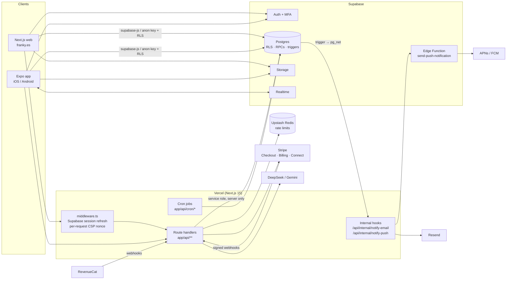

# Franky

**A platform for university students in Spain:** choosing a degree, finding a room and roommates, scholarships, events, and campus community. It has a web app and an iOS/Android app, in Spanish and English.

**Live:** [franky.es](https://franky.es) · **Role:** lead developer (Teferi) · **Status:** in production; also my final degree project (June 2026)

> Figures stated by the owner: 1,000+ registered users, 96 universities, 4,600+ degrees with admission cut-off grades, 380+ scholarships.

<!-- Screenshots: replace the placeholders with real captures -->
| Web | Mobile |
|---|---|
| `docs/screenshots/web-home.png` *(placeholder)* | `docs/screenshots/mobile-feed.png` *(placeholder)* |
| `docs/screenshots/web-degree.png` *(placeholder)* | `docs/screenshots/mobile-roomie.png` *(placeholder)* |

## What it does

- **Degrees and admission grades.** A catalogue of universities and degrees, with cut-off grades by year, a grade simulator, university comparison, and a vocational test (RIASEC / Big Five).
- **Scholarships.** A searchable catalogue with eligibility filters and deadline alerts (`scholarship_alerts`).
- **Housing and roommate matching.** Room listings, visit booking, and a compatibility score between students computed in Postgres (`calculate_compatibility`, cached in `compatibility_cache`).
- **Community.** Campus communities, an anonymous campus wall with polls and moderation, chats, friendships, stories, and reporting/blocking.
- **Marketplace.** Student-to-student listings, plus paid visits and rents through Stripe Connect.
- **Ticketed events.** Tickets with QR codes, a time-boxed seat hold during checkout, a waitlist, refunds, and door check-in.
- **Mobile app.** Expo app with push notifications, in-app purchases (RevenueCat), Apple sign-in, and ES/EN localisation.

## Tech stack

| Layer | Technology |
|---|---|
| Web | Next.js 15 (App Router), React 19, TypeScript, Tailwind CSS 4, Zod, framer-motion |
| Mobile | Expo 54, expo-router 6, React Native 0.81, i18n-js (ES/EN), Sentry |
| Backend | Supabase: Postgres with Row Level Security, RPCs, triggers, Realtime, Storage, Auth (MFA), and an Edge Function for push |
| Payments | Stripe Checkout, Billing, and Connect (destination charges with an application fee); RevenueCat for native in-app purchases |
| Email | Resend |
| Rate limiting | Upstash Redis (`@upstash/ratelimit`, sliding window) |
| AI | DeepSeek / Google Gemini (server-side, with a daily budget per user) |
| Quality | Vitest (≈270 test files), Playwright e2e, ESLint, `tsc --noEmit`, GitHub Actions, gitleaks, npm audit |
| Hosting | Vercel (web + cron jobs), Supabase (database), EAS (mobile builds) |

## Architecture



Clients read and write most data **directly through Supabase with the anon key**, so Row Level Security is the access-control layer. Next.js route handlers cover anything that needs a secret or a third party: payments, webhooks, email, AI, admin. They use the service-role client only on the server. [`docs/ARCHITECTURE.md`](docs/ARCHITECTURE.md) has the data model and the main flows.

## Notable technical decisions

All of these come from the code:

- **RLS-first security.** Postgres policies and `SECURITY DEFINER` RPCs enforce authorisation, not only the UI. Sensitive writes (roles, premium flags, payment state) go through guarded RPCs and triggers. Changes ship as idempotent migrations (`v2/supabase/migrations`).
- **Column-level encryption for PII.** A trigger keeps encrypted copies of the phone number and birth date (`profiles.phone_encrypted` / `birth_date_encrypted`) using `pgcrypto` (AES-256). The master key lives in `supabase_vault` (migration `041_pii_encryption_pgcrypto.sql`).
- **Rate limiting that survives serverless.** Upstash sliding-window counters are shared by every Vercel instance. If Redis is not configured, a per-instance in-memory token bucket takes over. Keys use **SHA-256-hashed IPs**, so raw IPs never reach Redis (`v2/web/src/lib/rate-limit.ts`).
- **Strict CSP with a per-request nonce.** `middleware.ts` generates a nonce for each request and builds a `script-src 'nonce-…' 'strict-dynamic'` policy. A `/api/csp-report` endpoint collects violations.
- **Idempotent Stripe webhooks.** Each event is claimed by `event.id` in a `webhook_events` table before it is processed, so retries are acknowledged as duplicates. Outgoing Stripe calls use idempotency keys. A reconcile job (`/api/internal/reconcile-payments`) catches anything that drifted.
- **Marketplace payments through Stripe Connect.** Destination charges with `application_fee_amount` and `transfer_data.destination`. Before a refund, the server cross-checks the stored payment against the PaymentIntent and Charge (amount, currency, livemode, destination).
- **Event-driven notifications.** Postgres triggers call `dispatch_email()`, which uses `pg_net` to POST to a shared-secret internal route. That route renders the email and sends it with Resend, with per-category throttling in `email_notification_log`. Push notifications go through a Supabase Edge Function to APNs (HTTP/2 + JWT) and FCM (HTTP v1).
- **Seat holds for tickets.** Seats are reserved for a database-defined window (`ticket_hold_window()`) that is a bit longer than a Stripe Checkout session, so a paid session never finds its seat released.
- **Validated environment.** `src/lib/env.ts` validates configuration with Zod. Features with missing keys degrade gracefully, for example email being disabled when `RESEND_API_KEY` is absent.
- **Password hygiene.** Passwords are checked against Have I Been Pwned using k-anonymity (only a hash prefix is sent). The admin panel requires an MFA session (AAL2).
- **Shared domain logic.** `v2/shared/*.ts` holds pure TypeScript (billing, academic scores, event lifecycle, and more) that both the web app and the mobile app import.
- **CI.** Typecheck, lint, and unit tests on every push; a production `next build`; mobile typecheck and lint; gitleaks; and `npm audit`. Local EAS build workflows for Android and iOS.

## Repository layout

```
.
├── v2/                      # current platform
│   ├── web/                 # Next.js 15 app (franky.es)
│   │   ├── src/app/         # pages (App Router) and app/api/** route handlers
│   │   ├── src/lib/         # Supabase clients, Stripe, rate limit, env, email, i18n…
│   │   ├── src/components/  # UI components
│   │   ├── src/__tests__/   # Vitest
│   │   └── e2e/             # Playwright
│   ├── mobile/              # Expo app (expo-router screens in app/, logic in src/)
│   ├── shared/              # TypeScript domain logic shared by web and mobile
│   └── supabase/
│       ├── migrations/      # schema, RLS policies, RPCs, triggers
│       └── functions/       # Edge Function: send-push-notification
├── docs/ARCHITECTURE.md     # data model and main flows
└── .github/workflows/       # CI, security scans, mobile builds
```

## Running locally

Requirements: Node 24 (web), a Supabase project (free tier is enough), and optionally Stripe test keys.

```bash
# 1. Database: create a Supabase project and apply v2/supabase/migrations in
#    filename order (Supabase CLI or the SQL editor). Some migrations expect
#    the pg_net, pgcrypto and supabase_vault extensions.

# 2. Web
cd v2/web
cp .env.example .env.local   # fill NEXT_PUBLIC_SUPABASE_URL, NEXT_PUBLIC_SUPABASE_ANON_KEY,
                             # SUPABASE_SERVICE_ROLE_KEY; everything else is optional
npm install
npm run dev                  # http://localhost:3000
npm test                     # Vitest
npm run typecheck

# 3. Mobile
cd ../mobile
cp .env.example .env.local   # EXPO_PUBLIC_SUPABASE_URL, EXPO_PUBLIC_SUPABASE_ANON_KEY (required);
                             # GOOGLE_MAPS_ANDROID_API_KEY for the Android map (optional)
npm install
npm start                    # Expo dev server
```

The catalogue data itself (universities, degrees, scholarships) is not part of this repository; a fresh database starts empty. Without Upstash keys, rate limiting runs in memory. Without Stripe or Resend keys, payments and email are disabled. **Never commit `.env.local`.** Only `NEXT_PUBLIC_*` and `EXPO_PUBLIC_*` values reach the client.

---

## En español

**Franky** es una plataforma para universitarios en España: carreras con notas de corte, becas, pisos y compañeros de piso, comunidad, mercado entre estudiantes y eventos con entrada. Tiene web ([franky.es](https://franky.es)) y app para iOS/Android, en español e inglés. Soy el desarrollador principal, y el proyecto es también mi Trabajo de Fin de Grado (junio de 2026).

Stack: Next.js 15 + React 19 + TypeScript, Expo / React Native, Supabase (Postgres con RLS), Stripe (incluido Connect), Resend, Upstash Redis y Vercel. Arriba están la arquitectura, las decisiones técnicas y cómo arrancarlo en local; el modelo de datos está en [`docs/ARCHITECTURE.md`](docs/ARCHITECTURE.md).
