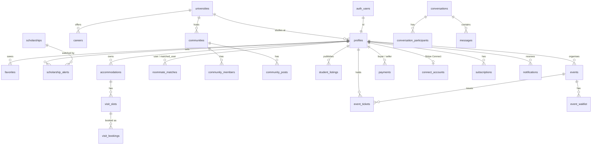
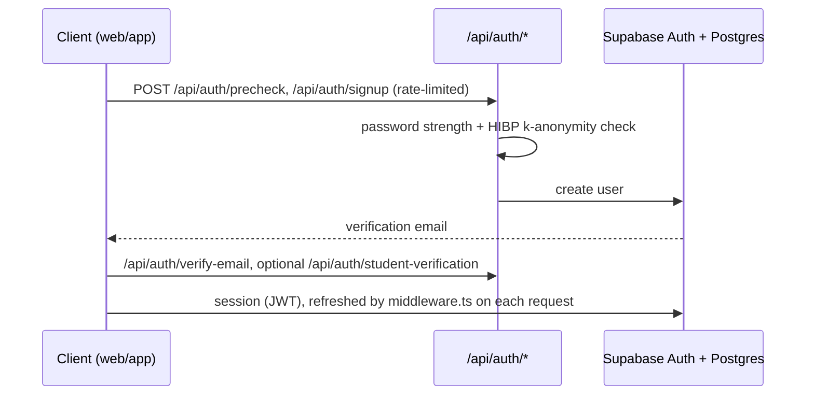
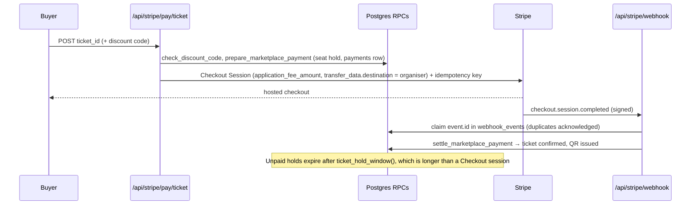
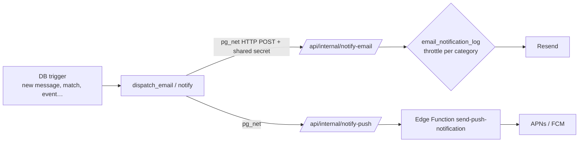

# Franky architecture

This document describes the current platform under `v2/`. Everything here comes from the code: the migrations in `v2/supabase/migrations`, the route handlers in `v2/web/src/app/api`, and the libraries in `v2/web/src/lib`.

## 1. Components

| Component | Path | Responsibility |
|---|---|---|
| Web app | `v2/web` | Next.js 15 App Router. Server-rendered public catalogue pages (SEO), authenticated app pages, and ~140 route handlers under `app/api/**` |
| Mobile app | `v2/mobile` | Expo / expo-router. Tabs: feed, explore, study, events, chats, crush, profile. ES/EN via `i18n-js` (`src/locales/{es,en}.ts`) |
| Shared logic | `v2/shared` | Pure TypeScript modules (billing, academic scores, event lifecycle, workspace rules) used by both apps |
| Database | `v2/supabase/migrations` | Postgres schema, RLS policies, RPCs (`SECURITY DEFINER` with pinned `search_path`), triggers |
| Edge Function | `v2/supabase/functions/send-push-notification` | Sends to every registered device of a user via APNs (HTTP/2 + JWT) and FCM (HTTP v1) |
| Scheduled jobs | `v2/web/vercel.json` → `app/api/cron/*` | Recurring billing and maintenance jobs on Vercel Cron |

### Two data paths

1. **Client → Supabase directly** (anon key + user JWT). Most reads and owner-scoped writes. **RLS is the authorisation boundary.**
2. **Client → Next.js route handler → Supabase with the service role.** Anything that needs a secret, a third party, or a cross-user invariant: payments, webhooks, email, AI, admin, account erasure. The service-role client (`lib/supabase-admin.ts`) exists only on the server.

## 2. Data model

There are about 290 tables, grouped below by domain. Only the core columns are listed. Each column comes from the `CREATE TABLE` in the migration named in brackets.

### Identity and profiles
- **`profiles`** [001]: `id → auth.users`, `full_name`, `avatar_url`, `university_id → universities`, `career`, `academic_year`, `bio`, `city`, `lifestyle_preferences` / `housing_preferences` (JSONB), `interests`, `role`, `is_premium`, `onboarding_completed`. Roommate attributes (smoking, study habits, sleep schedule, …) were added in [006].
- PII hardening: a trigger maintains `phone_encrypted` and `birth_date_encrypted` (`pgcrypto`, AES-256, key in `supabase_vault`) [041_pii_encryption_pgcrypto].
- **`student_email_verifications`** [025] and `student_email_domains`: verification of a university email address, which unlocks student-only features.
- Moderation and safety: `user_reports` [010], `user_blocks`, `blocked_users`, `muted_users`, `user_strikes`, `profile_photo_reports`.
- `account_private.*` [20260920185621_account_erasure]: bookkeeping for GDPR erasure. User-generated content is anonymised per table (for example, campus-wall posts lose their body and media and become anonymous), and the keys of erased objects are tracked as hashes.

### Academic catalogue
- **`universities`** [001]: `name`, `slug`, `type`, `city`, `comunidad_autonoma`, coordinates, `website`, `ranking_national`, `facilities`, …
- **`careers`** [001]: `university_id`, `name`, `branch`, `degree_type`, `duration_years`, `credits`, **`cut_off_score`**, **`cut_off_year`**, `places_offered`, `demand_ratio`, `campus`, `modality`, `riasec_scores`, `employment_rate`, `avg_salary`.
- **`scholarships`** [001]: `provider`, `type`, `amount_min/max`, `deadline`, `income_threshold`, `gpa_requirement`, `comunidad_autonoma`, `is_active`. **`scholarship_alerts`** [146] (`user_id`, `scholarship_id`, `notified_at`).
- Vocational test: `career_test_sessions`, `vocational_results`, `career_questions`, `career_profiles`, `recommendation_feedback`.
- Engagement: `favorites` (polymorphic `target_type` / `target_id`), `reviews`, `career_ratings`, `career_comments`, `notes` + `note_ratings`.

### Housing and roommates
- **`accommodations`** [001]: `owner_id`, `type`, `price`, `city`, coordinates, `rooms`, `amenities`, `images`, `university_ids`, `is_verified`, `status`.
- Visits: `visit_schedules`, `visit_slots`, `visit_bookings`, `visit_requests`. Leasing: `contracts`, `contract_signers`, `contract_signatures`, `tenancies`.
- **`roommate_matches`** [006] (`user_id`, `matched_user_id`, `compatibility_score`, `status`). The score comes from `calculate_compatibility(user1, user2)`, a weighted comparison of lifestyle answers (for example, smoking and study habits weigh 20 each, sleep schedule 15). Results are cached in **`compatibility_cache`** (`user_a`, `user_b`, `score`) [076].
- `swipe_actions` [011]: discovery swipes (`target_type`, `action`).

### Community and social
- **`communities`** / **`community_members`** / **`community_posts`** [138]: campus or interest communities with roles and private/public visibility.
- Anonymous campus wall: `fomo_threads`, `fomo_replies`, `fomo_reactions`, `fomo_polls` (+ options/votes), `fomo_reports`.
- Social graph and messaging: `friendships` [019] (`status`, `requested_by`), `follows`, `stories` (+ views and highlights), `conversations` / `conversation_participants` / `messages` [001], `message_reactions`, `chat_polls`.
- **`student_listings`** [137]: the marketplace (`kind`, `category`, `title`, `price_cents`, `status`, `university_id`).

### Events and ticketing
- **`events`** [001]: `organizer_id`, `university_id`, venue and coordinates, `start_date` / `end_date`, `category`, `price`, `max_capacity`, `status`.
- **`event_tickets`** [095]: `event_id`, `holder_id`, `original_buyer_id` (transfers), **`qr_token`**, `price_cents`, `status`, `order_id`, `used_at` (check-in).
- `event_participants`, `event_waitlist`, `event_discount_codes`, `event_rules`, `event_shirt_sizes`.

### Payments and billing
- **`payments`** [085]: one ledger for marketplace money. `type`, `buyer_id`, `seller_id`, `ref_table` / `ref_id` (ticket, visit or rent), `amount_cents`, `application_fee_cents`, Stripe ids (checkout session, payment intent, charge, connect account), `status`, `refunded_cents`.
- **`connect_accounts`** [085]: Stripe Connect onboarding state (`charges_enabled`, `payouts_enabled`, `requirements_currently_due`).
- **`webhook_events`** [116]: `event_id` primary key, used for webhook idempotency.
- Subscriptions: `subscriptions` [001], `owner_subscriptions`, `business_subscriptions`, `pro_subscriptions`, `organization_subscriptions`. Native IAP: `native_entitlements`, `native_billing_events` (RevenueCat).
- Integrity: `payment_checkout_state`, `payment_review_queue`, `payment_disputes`.

### Notifications
- **`notifications`** [001]: the in-app inbox (`type`, `title`, `body`, `data`, `is_read`).
- `device_tokens`, `push_delivery_outbox`, `notification_preferences`.
- **`email_notification_log`** [089]: per-user, per-category throttle (`last_sent_at`).

### Other domains in the schema
B2B workspaces for universities and organisations (`organizations*`, `workspace_*`), a loyalty card for local businesses (`franky_card_*`), bookings for venues and professionals (`pro_*`, `professional_*`), growth and referrals (`growth_*`), and admin and audit logs (`admin_audit_log`, `admin_actions`, `security_incidents`, `csp_violations`).

## 3. Main flows

### 3.1 Sign-up and session

- `middleware.ts` refreshes the Supabase session cookie, sets a per-request CSP nonce, and sets the document language (`/en` → `en`).
- The admin panel requires an MFA session (`aal2`, `lib/aal.ts`).

### 3.2 Paid ticket (Stripe Connect)

- Visits (`/api/stripe/pay/visit`) and rent (`/api/stripe/pay/rent`) use the same `marketplacePay` path with a different `ref_table`.
- Refunds and disputes (`charge.refunded`, `refund.*`, `charge.dispute.*`) update `payments`. Before refunding, the server checks that the stored payment matches the PaymentIntent and Charge.
- `/api/internal/reconcile-payments` reconciles anything that drifted.

### 3.3 Notifications (email and push)

### 3.4 Roommate matching
1. The user fills in lifestyle and housing preferences (`profiles`, migration 006).
2. `calculate_compatibility(a, b)` returns a 0–100 score from the weighted criteria.
3. The scores are cached in `compatibility_cache`, and matches are stored in `roommate_matches` (migration 088 notifies both users).

### 3.5 Account erasure (GDPR)
`/api/account/erase` (or `/api/account/delete`) → erasure RPCs [20260920185621]: Auth deletion, stopping billing, Apple token revocation, per-table anonymisation of user content, and storage object cleanup tracked by hashed keys.

## 4. Cross-cutting concerns

| Concern | Implementation |
|---|---|
| Rate limiting | `lib/rate-limit.ts`: Upstash sliding window (`franky:rl` prefix), SHA-256-hashed client IP or subject, in-memory fallback |
| CSP | `middleware.ts`: nonce + `strict-dynamic`; violations go to `/api/csp-report` → `csp_violations` |
| Configuration | `lib/env.ts`: Zod-validated environment; `.env.example` lists every variable |
| Input safety | `lib/sanitize.ts` (DOMPurify), `lib/upload-validate.ts`, `lib/read-limited-body.ts`, `lib/honeypot.ts` |
| i18n | Web: `lib/i18n.ts` (`es` default, `/en` landing, `hreflang` alternates). Mobile: `i18n-js` + `expo-localization` |
| Testing | Vitest (`v2/web/src/__tests__`), Playwright (`v2/web/e2e`), CI on GitHub Actions |
